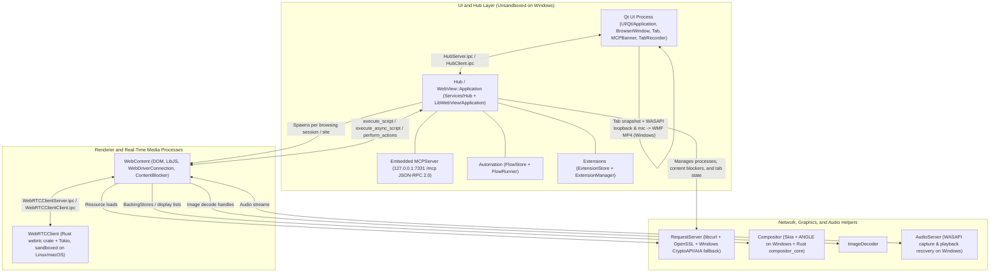
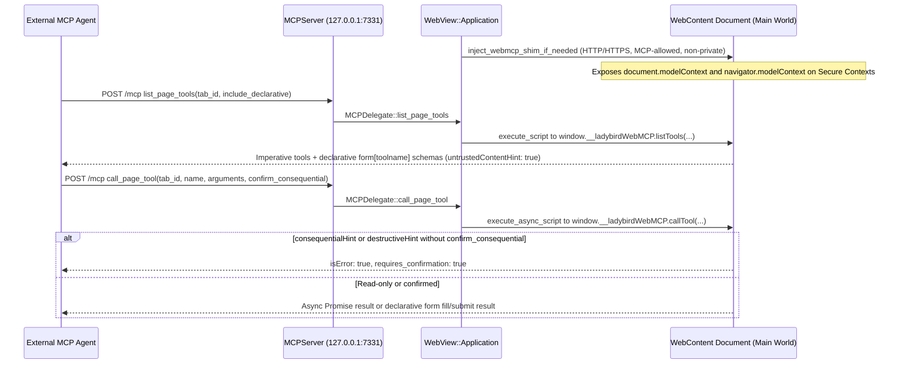

# Ladybird Fork Architecture and Capabilities (`feat/extensions-dnr-and-dom-tools`)

> **Scope and Baseline:** This manual documents the architecture, subsystems, security model, and verified behavior implemented on branch `feat/extensions-dnr-and-dom-tools` (including post-`339c5083` **Tab Containers**).

## 1. Executive Summary

This fork extends upstream multi-process Ladybird with five capability layers while keeping real-time automation, extensions, session isolation, and media tooling unified inside one profile:

1. **Embedded Model Context Protocol (`MCP`) and WebMCP Phase 1**: An in-browser HTTP + JSON-RPC 2.0 `MCPServer` (`LibMCP`) exposing 43 tools across tab control (`open_tab` supporting `container_id`), Document Object Model (`DOM`) inspection, input synthesis, diagnostics, reusable flows, unpacked extensions, and `document.modelContext` / `navigator.modelContext` WebMCP page tools.
2. **Declarative Browser Automation (`Automation` and `about:flows`)**: A persistent JSON flow store (`FlowStore`), state-machine executor (`FlowRunner`), browser-based `about:flows` builder (`FlowsUI`), and an external Node.js Engine Protocol v1 adapter ([`Tools/e2e-ladybird-engine/README.md`](../Tools/e2e-ladybird-engine/README.md)).
3. **Native Manifest V3 (`MV3`) Extensions and `declarativeNetRequest` (`DNR`)**: A native unpacked extension registry (`ExtensionStore`), content-script and adblock orchestrator (`ExtensionManager`) feeding `Web::ContentBlocker`, the `about:extensions` management page (`ExtensionsUI`), three bundled extensions, and Windows CryptoAPI / Authority Information Access (`AIA`) TLS chain fallback in `RequestServer`.
4. **Native Tab Containers (`ContainerStore`, `BrowsingSession`, `UI/Qt`)**: Persistent multi-account tab containers (`personal`, `work`, `banking`, `shopping`, plus custom containers) with isolated cookies, DOM storage, SQLite databases, HTTP caches, `WorkerAgentManager` session routing, `SessionStore` v13 persistence, and Qt tab visual badges/menus.
5. **Real-Time WebRTC Media and Segmented `MP4` Tab Recording**: Windows Media Foundation (`WMF`) camera capture, H.264 / VP8 Media Foundation Transform (`MFT`) encoding, Windows Audio Session API (`WASAPI`) capture and recovery, Rust `webrtc` media/ICE transport, and sequential `MP4` tab recording with speaker diarization (`TabRecorder` and `SpeakerTimeline`).

*Architectural rationale:* These layers share a single host controller (`WebView::Application`) so extensions can bundle reusable automation flows and filter lists, MCP agents can invoke flows and WebMCP tools inside the user's authenticated session, and W3C WebDriver detection (`navigator.webdriver`) remains `false` outside external WebDriver sessions.

---

## 2. Terminology, Process Topology, and Platform Support

### 2.1 Glossary of Ladybird-Internal Terms

- **`Hub` (`Services/Hub` and `WebView::Application`)**: The privileged browser backend layer that owns browsing sessions, tab view state, helper process lifetimes, content blockers, and profiles.
- **`WebContent` (`WebContentClient` / `WebContentPage`)**: The per-session / per-site renderer process executing the DOM, `LibJS`, layout/painting, `Web::ContentBlocker` (Rust `adblock`), and `WebDriverConnection`. `WebContentClient` and `WebContentPage` are the Hub-side IPC client and view bindings.
- **`WebUI`**: Ladybird's internal bridge connecting privileged `about:*` HTML/JS pages (such as `about:flows` and `about:extensions`) to C++ handlers (`FlowsUI`, `ExtensionsUI`) via `ladybird.sendMessage`.
- **`BackingStores` and `AnonymousBuffer`**: Shared-memory pixel/data buffers (`AnonymousBuffer`) passed across IPC between processes to present rendered frames cleanly or push compiled content-blocker lists.
- **`WebDriverConnection`**: The in-renderer script and synthetic-input executor shared by external W3C WebDriver clients and internal `MCP` / `Automation` / `Extensions` commands.
- **`VERIFY(...)` and `MUST(...)`**: Core assertion macros (`AK`) that remain active in release builds and abort the process immediately on failure.
- **`Lagom`**: Build prefix used for Ladybird's cross-platform host libraries (`lagom-webview.dll`, `lagom-mcp.dll`, etc.).

### 2.2 Multi-Process Topology

Depending on the host OS, Ladybird runs `Services/Hub` either as a separate helper executable (`LADYBIRD_HUB_IN_OWN_PROCESS` enabled on Linux and macOS in `UI/CMakeLists.txt`) or linked directly into the Qt UI executable (`UI/Qt/Application.cpp` implementing `Hub::ApplicationHost` and instantiating `Hub::Application` / `WebView::Application` over an in-memory `IPC::TransportHandle::create_pair()` on Windows and BSDs). Both modes use the same `HubServer.ipc` / `HubClient.ipc` Inter-Process Communication (`IPC`) protocol.

### 2.3 Key Hosting Facts and Module References

- **In-process Hub (Windows and BSDs)**: `UI/Qt/Application.cpp` hosts `Hub::Application` in-process and links `hubservice` when `!LINUX && !APPLE`. On Windows (`if(WIN32)`), the Qt target links `LibDevTools` and `LibMCP` directly; `Libraries/LibWebView/CMakeLists.txt` also links `LibDevTools` and `LibMCP` as `PRIVATE` dependencies of `LibWebView` (covering BSD builds transitively). On Windows, running `Ladybird.exe` locks `lagom-webview.dll` and `lagom-mcp.dll`, so browser processes must be terminated before relinking. In headless mode, the in-process Hub bypasses Qt UI bindings.
- **Out-of-process Hub (Linux and macOS)**: `UI/Qt/Application.cpp` spawns the `Hub` executable over a Mach port pair (macOS) or `AF_LOCAL` `socketpair` (Linux). `Services/Hub/main.cpp` spawns a `UIExitWatcher` thread (`kqueue` on macOS/BSD, `pidfd_open` on Linux) that currently has no Windows implementation (`FIXME`).

| Subsystem | Windows | Linux | macOS |
| :--- | :--- | :--- | :--- |
| Hub hosting | In-process (`UI/Qt`) | Out-of-process (`Hub`) | Out-of-process (`Hub`) |
| Process sandbox (`WebContent` / `WebRTCClient`) | Unsandboxed (`SandboxUnimplemented`) | Seccomp + Landlock | Seatbelt |
| TLS fallback (`RequestServer`) | OpenSSL + `CURLSSLOPT_NATIVE_CA` + CryptoAPI/AIA | OpenSSL + AIA | OpenSSL + AIA |
| Audio backend (`AudioServer`) | WASAPI (capture + device-loss reopen) | PulseAudio / PipeWire / platform | CoreAudio |
| WebRTC Video TX / RX | WMF H.264/VP8 TX + WMF/FFmpeg RX | No WMF TX; FFmpeg RX | No WMF TX; FFmpeg RX |
| `TabRecorder` (`MP4`) | Supported (`Q_OS_WIN` + WMF) | Unsupported (returns error popup) | Unsupported (returns error popup) |

Module documentation:

- [LibMCP Module README](../Libraries/LibMCP/README.md)
- [Automation Module README](../Libraries/LibWebView/Automation/README.md)
- [Extensions Module README](../Libraries/LibWebView/Extensions/README.md)
- [e2e Engine Protocol Adapter README](../Tools/e2e-ladybird-engine/README.md)

---

## 3. Embedded MCP Server and WebMCP Phase 1

The embedded `LibMCP` server (`Libraries/LibMCP/MCPServer.cpp`) binds exclusively to `127.0.0.1` (default port `7331` when launched with `--mcp`) and delegates actions through `MCP::MCPDelegate`, implemented by `WebView::Application` (`Libraries/LibWebView/Application.cpp`).

### 3.1 Tool Surface (43 Tools)

1. **Tabs and Navigation (9)**: `list_tabs`, `get_active_tab`, `open_tab`, `switch_tab`, `close_tab`, `navigate`, `reload`, `go_back`, `go_forward`.
2. **DOM, Input, and Diagnostics (18)**: `get_accessibility_tree`, `get_dom_tree`, `get_page_source`, `find_elements`, `click`, `type_text`, `get_page_snapshot` (assigns compact `@e1` handles referencing visible interactive elements until DOM replacement or navigation), `press_key`, `scroll`, `hover`, `drag`, `upload_file`, `select_option`, `wait_for`, `get_console_logs`, `get_network_requests`, `eval_js`, `take_screenshot`.
3. **Automation Flows (8)**: `list_flows`, `get_flow`, `save_flow`, `delete_flow`, `run_flow`, `list_flow_runs`, `get_flow_run`, `cancel_flow_run`.
4. **Extensions (6)**: `list_extensions`, `install_unpacked_extension`, `set_extension_enabled`, `reload_extension`, `remove_extension`, `inject_extension`.
5. **WebMCP Page Tools (2)**: `list_page_tools`, `call_page_tool`.

### 3.2 Per-Tab Opt-In, UI Integration, and Command Queue

- User-opened tabs start with `m_mcp_access_allowed = false` (`ViewImplementation`). Tabs opened via `open_tab` or `run_flow` (`open_new_tab: true`) auto-enable MCP access (`Application::open_mcp_new_tab` and `open_automation_tab`).
- **Known Private-Tab Defect:** In `0aa20e0a`, `find_allowed_mcp_view`, `find_automation_view`, `list_allowed_tabs`, `active_allowed_tab`, and `set_mcp_access_allowed` do **not** check `is_private()`. Only `inject_webmcp_shim_if_needed` rejects `IsPrivate::Yes`. Because `MCPBanner` (`UI/Qt/MCPBanner.cpp`) and the `Tab` context menu (`Allow MCP Access` / `Revoke MCP Access`) also remain enabled in private windows, manually allowing MCP on a private tab exposes it to MCP and Automation tools.
- Each view uses a serial `MCPViewQueue` in `Application`: commands dispatch sequentially into `WebDriverConnection` under a `15 s` single-shot `in_flight_timer`. On timeout, revocation (`did_revoke_mcp_access_for_view`), or close (`did_close_mcp_view`), `Application` clears `m_mcp_command_to_view` and `in_flight_command_id` so subsequent non-input commands can proceed. However, if the timed-out command was an input-state operation (`click`, `type_text`, `upload_file`, `perform_actions`), `ViewImplementation::m_webdriver_input_command_running` remains `true`, stalling future input commands on that view, and `WebDriverConnection` can hit `VERIFY(!m_current_command_id.has_value())` if a new command arrives before WebContent's `30 s` script timeout expires.
- **`navigator.webdriver` preservation**: `Services/WebContent/WebDriverConnection.cpp` enables `page.set_is_webdriver_active(true)` and disables pop-up blocking only inside `set_session_config` (invoked by external W3C WebDriver clients). Internal MCP, Flow, and Extension scripts leave `navigator.webdriver === false`.

### 3.3 Main World vs. Isolated World and WebMCP Phase 1

Unlike browser isolated worlds (separate JS global and prototype environments where Chrome/Firefox extensions run), both injected extension scripts and the WebMCP Phase 1 shim execute via `WebDriverConnection` inside the page's **Main World** (the same `window`, `document`, and prototypes used by webpage scripts) and arrive asynchronously over IPC.

- **Injection condition**: `inject_webmcp_shim_if_needed` injects `mcp_webmcp_shim_js` on `http:` and `https:` MCP-allowed, non-private tabs. The JS shim itself exposes `document.modelContext` and `navigator.modelContext` (`registerTool`, `unregisterTool`, `provideContext`, `clearContext`) only in Secure Contexts (`window.isSecureContext`, `https:`, `localhost`, `127.0.0.1`, or `[::1]`).
- **Declarative forms & safety annotations**: Scans `document` and open `shadowRoot` trees for `form[toolname]` (synthesizing JSON Schemas from `form.elements` and dispatching `toolactivated`), forces `untrustedContentHint: true` on all discovered page tools, and blocks `consequentialHint` / `destructiveHint` execution unless `confirm_consequential: true` is passed by the caller.

### 3.4 CLI Flags and Security Controls

| Flag | Default | Effect | Source |
| :--- | :--- | :--- | :--- |
| `--mcp [port]` | Disabled (`7331` if port omitted) | Starts embedded `MCPServer` on `127.0.0.1` | `Libraries/LibWebView/Application.cpp`, `Options.h` |
| `--mcp-token <token>` | 32 random bytes (64 hex chars, printed to stdout) | Overrides the generated Bearer token | `Libraries/LibWebView/Application.cpp` |
| `--mcp-upload-dir <directory>` | Unset | Confines `upload_file` to `<directory>` and checks intermediate symlinks | `Libraries/LibWebView/Options.h`, `Application.cpp` |
| `--mcp-allow-extension-install` | `false` | Enables `install_unpacked_extension` over MCP (`about:extensions` remains enabled in UI) | `Libraries/LibWebView/Options.h`, `Application.cpp` |

---

## 4. Declarative Automation (`Automation` and `Tools/e2e-ladybird-engine`)

- **Engine (`Libraries/LibWebView/Automation/`)**: `FlowTypes` defines 15 step actions and 7 locator strategies (`css`, `xpath`, `role`, `label`, `placeholder`, `text`, `test_id`) with `nth` bounded to `0..1000` and single-pass `{{var}}` substitution. `FlowStore` persists flows under `<data_dir>/automation/flows/` (or instance storage directory), returns an error from `delete_flow` when missing, caps run history at `max_in_memory_runs = 50`, and prunes evicted run JSONs and `_step_*.png` screenshots from disk. `FlowRunner` executes steps asynchronously; `reload` checks for `about:` error pages, and `extract`, `eval`, and `screenshot` (when `save_as` is set) populate `record.outputs` and `runtime_vars` for downstream `{{var}}` interpolation.
- **Built-in UI (`about:flows`)**: `FlowsUI` (`Libraries/LibWebView/WebUI/FlowsUI.cpp`) connects `Base/res/ladybird/about-pages/flows.html` directly to `FlowStore` and `FlowRunner`, supporting browser-based flow authoring and execution without requiring MCP tab opt-in (`require_mcp_permission = false`).
- **External harness adapter ([`Tools/e2e-ladybird-engine/README.md`](../Tools/e2e-ladybird-engine/README.md))**: Translates `e2e` Engine Protocol v1 (`Content-Length`-framed JSON-RPC over `stdio`) to HTTP `POST /mcp` calls using `LADYBIRD_MCP_URL` and `LADYBIRD_MCP_TOKEN`, stamping temporary `data-e2e-ref` attributes for element observation and returning `STALE_REF`, `NOT_FOUND`, or `NOT_ACTIONABLE` diagnostics.

---

## 5. Native MV3 Extensions, DNR, and `RequestServer` TLS

- **Manifest & Storage (`Libraries/LibWebView/Extensions/`)**: `ExtensionStore` manages unpacked extensions (loaded directly from local folders) in `<data_dir>/extensions/registry.json` (`schema_version: 1`) and `<data_dir>/extensions/storage/<id>.json`. Parses MV3 `content_scripts`, `action`, `declarative_net_request.rule_resources`, and the custom `ladybird` manifest block (`id`, `flows`, `filter_lists`).
- **Path Safety**: `resolve_safe_extension_file_path` (`ExtensionTypes.cpp`) rejects disallowed relative paths (absolute paths, `\`, `:`, `.`, `..`, NUL bytes), checks every directory segment with `FileSystem::is_link`, canonicalizes with `FileSystem::real_path`, enforces containment under the extension root, and requires `FileSystem::is_regular_file`.
- **Execution & Content Blocking (`ExtensionManager`)**:
  - `CanonicalTraversable::commit_navigation` (`document_start` + WebMCP shim) and `WebContentPage::did_finish_loading` (`document_end` / `document_idle`) trigger `ExtensionManager::did_start_load` / `did_finish_load`, executing scripts in the page's Main World via `execute_script` with an IIFE receiving `(browser, ladybirdExt)` backed by a read-only `storage.local.get` snapshot.
  - Translates DNR `"block"` and `"allow"` (`@@` exception prefix) rules (`urlFilter`, `requestDomains`, `initiatorDomains`, `excludedInitiatorDomains`, mapped `resourceTypes`) plus raw `ladybird.filter_lists` adblock syntax (`$options`, `##` cosmetic hiding selectors) into `Application::load_content_blocker_lists()` -> `Web::ContentBlocker`.
  - Bundled extensions in `Tools/`: `example-extension` (`ladybird-page-inspector`), `extensions/table-enhancer` (`ladybird-table-enhancer`), and `extensions/youtube-clean-and-adblock` (`ladybird-youtube-clean-adblock`).
- **Windows TLS Chain Validation (`Services/RequestServer/`)**: `CURL.cpp` sets `CURLOPT_SSL_OPTIONS` to `CURLSSLOPT_NATIVE_CA` when no custom certificate path is configured. When OpenSSL encounters missing local issuer errors (`X509_V_ERR_UNABLE_TO_GET_ISSUER_CERT_LOCALLY`, `X509_V_ERR_UNABLE_TO_GET_ISSUER_CERT`, or `X509_V_ERR_SELF_SIGNED_CERT_IN_CHAIN`), `AIA.cpp` falls back to `verify_chain_with_windows_cryptoapi` (`CertGetCertificateChain` with cached revocation + `CERT_CHAIN_POLICY_SSL`) alongside HTTP Authority Information Access (`AIA`) intermediate CA fetching.

---

## 5.5 Native Tab Containers (`ContainerStore`, Engine Isolation, Hub IPC, and Qt UI)

- **Registry (`Libraries/LibWebView/ContainerStore.{h,cpp}`)**: Persists `TabContainer { id, name, color }` entries in `<profile.paths().config>/Containers.json`, seeding four defaults (`personal`, `work`, `banking`, `shopping`) on first load and exposing validation (`is_valid_container_id`, `is_valid_container_color`), creation, deletion, and `ContainerStoreObserver`.
- **Engine Isolation (`BrowsingSession`, `CookieJar`, `WorkerAgentManager`, `RequestServerManager`, `WebView::Application`)**:
  - Each active `container_id` resolves lazily to a distinct non-private `BrowsingSession` backed by `<profile.paths().data>/Containers/<id>/Ladybird.db` (cookies, localStorage/sessionStorage/IDB) and `<profile.paths().data>/Containers/<id>/Permissions.json`.
  - `CookieJar::TransientStorage` filters live cookie change broadcasts by `m_owner_jar` pointer identity so cookie updates never cross containers.
  - `WorkerAgentManager::post_broadcast_channel_message` and `WebWorkerClient` isolate `BroadcastChannel` and `SharedWorker` coordination by `session_id` rather than `IsPrivate`.
  - `RequestServerManager` isolates site HMAC keys by `container_id` and scopes RequestServer HTTP caches under `RequestServer/Containers/<id>`.
- **Hub IPC, Qt UI, Persistence & MCP**:
  - `Services/Hub` (`HubClient.ipc` / `HubServer.ipc`) synchronizes `TabContainerInfo`, `containers_changed`, `create_container`/`delete_container`, and per-view `container_id` across in-process and out-of-process Hub builds.
  - `UI/Qt` provides right-click on the `+` new-tab button, Ladybird menu -> *New Container Tab*, tab context menu -> *Reopen in Container*, duplicate-tab preservation, colored tab accent stripes/tooltips (`TabBar`), and `SessionStore` schema v13 (`SessionTabs.container_id`) persistence across restart/reopen.
  - `LibMCP` exposes `container_id` on `TabInfo` and accepts optional `container_id` in `open_tab`.

---

## 6. Real-Time Media, WebRTC, and Segmented `MP4` Tab Recording

- **MediaCapture & AudioServer WASAPI**:
  - `WindowsMediaFoundationCamera.cpp` shares hardware cameras (`CameraHub` / `SharedCameraSession`) via async `IMFSourceReader`, converting `RGB32`, `ARGB32`, `NV12`, and `YUY2` samples into `BGRx8888`.
  - `Services/AudioServer/AudioDevicesWasapi.cpp`, `RecordStreamWasapi.cpp`, and `PlaybackStreamWasapi.cpp` implement WASAPI endpoint enumeration, hot-plug notifications (`IMMNotificationClient`), float32 auto-conversion with mix-format fallback, capture-loss recovery, and default render device reopening.
- **WebRTC (`Libraries/LibWebRTC/Rust/`, `Services/WebRTCClient/`, `Libraries/LibWeb/WebRTC/`)**:
  - Rust `webrtc` service caps resources (256 PeerConnections, 1,024 transceivers / senders / data channels), restricts Interactive Connectivity Establishment (`ICE`) to IPv4 UDP (`Udp4`), filters privileged STUN/TURN ports (`< 1024` except `53`, `80`, `443`), resolves hostnames via renderer `ResolveHost` (bypassing initialization deferral for `InitTransport` and RTP Synchronization Source `SSRC` lookups), applies Multicast DNS (`mDNS`) host obfuscation unless Microphone permission is granted, strips non-mDNS/`ssltcp` candidates, and registers `video/rtx` Retransmission Payload Types (`RTX`/`FID`) after default interceptors.
  - `video_rx.rs` implements out-of-order RTP sequence reassembly (`SeqUnwrapper`, 128-packet buffer) and depacketization for VP8, VP9, H.264 (caching `STAP-A` `SPS`/`PPS` parameter NALUs), and AV1 (`OBU` assembly).
  - `RTCPeerConnection` handles 48 kHz Opus audio TX/RX with Root-Mean-Square Voice Activity Detection (`RMS VAD`), Windows-only WMF H.264/VP8 video TX encoding, and WMF (Windows H.264) / FFmpeg video RX decoding.
- **`TabRecorder` and `SpeakerTimeline` (`UI/Qt/TabRecorder.cpp`, `Libraries/LibMediaCodecs/SpeakerTimeline.cpp`)**:
  - Windows-only (`Q_OS_WIN`) recording via toolbar `RecordButton` or `Ctrl+Shift+R`. Enables CPU backing stores (`set_recording_active`), samples frames up to `1920x1080` on a `Qt::PreciseTimer`, composites cursor/click indicators, mixes WASAPI loopback + microphone signed 16-bit little-endian (`S16LE`) `48 kHz` stereo PCM, and writes sequential `MP4` batches (`part_NNN.mp4`, `part_NNN.speakers.json`, `session.json`, `concat.txt`) inside `<recordings_dir>/<session_id>/` (rotating every `300 s` by default via `batch_duration_seconds`, clamped across UI presets `0`–`900 s`) using `WindowsMediaFoundationMp4Recorder` (Multi-Threaded Apartment `MTA` COM `IMFSinkWriter`, H.264 + AAC) so completed parts persist if the session aborts unexpectedly.
  - `SpeakerTimeline` coalesces WebRTC activity and fallback WASAPI VAD turns using hardcoded Spanish speaker labels (`"Yo"` for local microphone, `"Asistente N"` for remote speakers), dropping segments `< 150 ms` (unless all raw segments are `< 150 ms`) and merging gaps `<= 500 ms`.

---

## 7. Security Model, Verified Risks, and Test Coverage

### 7.1 Hardened P0 Fixes and Remaining Architectural Risks

The P0 and Sprint 2 P1 hardening fixes resolve the critical audit findings across commits `81bb5684`–HEAD:

- **Private-tab isolation (`LibMCP` / `LibWebView` / `UI/Qt` / `Extensions`)**: `ViewImplementation::is_mcp_access_allowed`, `set_mcp_access_allowed`, `find_allowed_mcp_view`, `find_automation_view`, `list_allowed_tabs`, `active_allowed_tab`, `FlowsUI::send_state`, `BrowserWindow` (`MCPBanner`), `Tab` (`Allow MCP Access`), `RemoteView`, and `Hub::Application::open_mcp_new_tab` enforce `IsPrivate::No`. `ExtensionManager::collect_combined_filter_rules(IsPrivate)` and separate normal/private content-blocker buffers in `Application` enforce `allow_in_private` for DNR/adblock rules too.
- **MCP/HTTP, WebDriver & Upload hardening (`LibHTTP` / `LibMCP` / `LibWebView` / `WebContent`)**: `HttpRequest::from_raw_request` keeps `64 KiB` header limits while accepting up to `4 MiB` request bodies; `MCPServer` validates `Mcp-Session-Id` (`404` on mismatch) and caps concurrent active connections at `64` (`503`); `MCPViewQueue` uses a `35 s` command timeout with `ViewImplementation::cancel_webdriver_content_command` and safe `WebDriverConnection::run_command` superseding; `validate_mcp_upload_path` rejects `\r`/`\n`, UNC paths, and OS Ladybird profile dirs, `Application::upload_file` enforces `<input type="file">`, and `WebDriverConnection::element_send_keys_impl` enforces a `128 MiB` file size cap; `mcp_webmcp_shim_js` freezes `modelContext`/`api` (`Object.freeze`) and defines `document.modelContext`/`navigator.modelContext` `configurable: false`.
- **Extensions/DNR safety**: `ExtensionStore::set_last_error` supports `notify_observers = false` (eliminating `collect_combined_filter_rules` / `sync_bundled_flows` re-entrancy), `install_unpacked` rejects conflicting directory IDs, `sync_bundled_flows` rejects unowned `FlowStore` ID collisions, and `translate_dnr_ruleset_to_adblock_rules` validates domains and strips `\r`/`\n`/`$`/`##` injections.
- **WASAPI, WMF & `TabRecorder` (`AudioServer` / `LibMediaCodecs` / `UI/Qt`)**: `PlaybackStreamWasapi` and `RecordStreamWasapi` eliminate uninitialized `GetMixFormat`, fatal `VERIFY` format panics, `channel_volumes` races, detached render threads, and capture-thread self-deletion UAF. `WindowsMediaFoundationCamera` guards odd-dimension `NV12` bounds with `Checked<size_t>`, `WindowsMediaFoundationVideoEncoder` bounds `OutputTypeNeeded` renegotiation (`<= 4` attempts), `WindowsMediaFoundationVideoDecoder::ThreadData` releases `m_mutex` before completion callbacks (guarded by `m_callback_mutex`), and `TabRecorder` swaps `m_recorder` atomically during batch rotation, eliminates `< 1 ms` audio busy-spin, propagates worker errors via `handle_worker_failure`, and bounds `start()` init waits (`10 s`).
- **Windows AIA & WebRTC endpoint hardening (`RequestServer` / `LibWebRTC`)**: `AIA.cpp` filters non-public HTTP AIA URLs and enforces Subject Alternative Name presence after Windows CryptoAPI fallback; `service.rs` filters remote ICE candidates targeting ports `< 1024` (other than `53`, `80`, `443`) or link-local/unspecified/broadcast/multicast endpoints.

- **WebRTC (`RTCPeerConnection` / `LibWebRTC`)**: `RTCPeerConnection::finalize()` performs GC-safe native teardown (deactivating outgoing audio/video `FrameSink` objects, closing native connections, clearing decoders and pending request tables, and unregistering IDs without dereferencing swept GC siblings), and remote RTP video/audio packet reception allocates `FixedArray<u8>` fallibly on OOM.

Remaining hardening / P2 architectural risks:

| Severity | Subsystem | Verified Hazard and Location |
| :--- | :--- | :--- |
| **High (`P1`)** | `LibMCP` (`upload_file`) | `FileSystem::real_path` does not expand NTFS junctions on Windows (`LibFileSystem`), and without `--mcp-upload-dir`, regular non-symlink files outside the credential/profile blocklist remain accessible. |
| **High (`P1`)** | `Extensions` / WebMCP | Both systems inject asynchronously via `execute_script` into the Main World after commit (no isolated JS world; early `<head>` scripts may run first), `confirm_consequential` has no native Qt confirmation dialog, `permissions`/`host_permissions` are unenforced in JS, and `FlowsUI` interpolates `extract`/`eval`/`screenshot` `save_as` values unescaped into `{{var}}`. |
| **Medium (`P2`)** | `WebRTC` / Windows | Windows `WebRTCClient` and `WebContent` are unsandboxed (`SandboxUnimplemented.cpp`). |

### 7.2 Verification Suites (Current Tab Containers Build)

| Test Binary / Suite | Scope / Verified Count | Command / Scope Covered |
| :--- | :---: | :--- |
| `TestLibWebView` (`TestContainers`) | `2/2` | `./Build/release/bin/TestLibWebView[.exe] --suite TestContainers` — `ContainerStore` defaults/persistence and per-container `BrowsingSession`/`CookieJar` isolation |
| `TestLibWebView` (`TestExtensions`) | `9/9` | `./Build/release/bin/TestLibWebView[.exe] --suite TestExtensions` — paths/symlinks, URL patterns, manifests, store, injection, DNR translation |
| `TestLibWebView` (`TestMCPAutomation`) | `6/6` | `./Build/release/bin/TestLibWebView[.exe] --suite TestMCPAutomation` — Auth/Host/Origin guards, 43 schemas (including `open_tab.container_id`), flows/extensions, agentic/WebMCP roundtrips, upload path validation |
| `TestLibWebView` (`TestAutomationFlows`) | `6/6` | `./Build/release/bin/TestLibWebView[.exe] --suite TestAutomationFlows` — IDs, roundtrip JSON, `{{var}}`, locator escaping, `FlowStore` persistence |
| `TestLibWebView` (`TestOmnibox`) | `79/79` | `./Build/release/bin/TestLibWebView[.exe] --suite TestOmnibox` — URL, history, and `about:` WebUI suggestions |
| `TestUIQt` (all Windows Qt suites) | `270/270` | `./Build/release/bin/TestUIQt[.exe]` — Qt chrome, session store schema v13 + `container_id` persistence (`TestSessionStore` `114/114`), snapshot storage (`61/61`), site settings, `TabRecorder` |
| `TestLibMedia` (`TestWindowsMediaFoundationEncode.cpp`) | `11` test cases (compiled on `WIN32`) | `./Build/release/bin/TestLibMedia[.exe] --suite TestWindowsMediaFoundationEncode` — WMF H.264/VP8, camera sharing, `SpeakerTimeline`, `WindowsMediaFoundationMp4Recorder` |
| `Tests/LibWeb/Text/input/WebRTC/*.html` | `17` text tests | PeerConnection lifecycle, audio/video loopback, mDNS obfuscation, permissions, RTX/FID, transforms |
| `Tools/e2e-ladybird-engine/test/engine-protocol.test.mjs` | `2` Node tests | `node --test Tools/e2e-ladybird-engine/test/engine-protocol.test.mjs` — Protocol framing and mocked MCP engine roundtrips |
