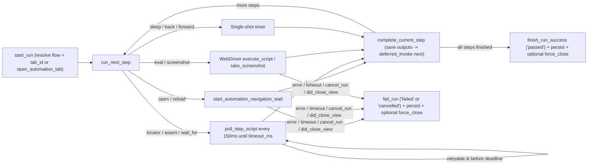

# Declarative Browser Automation (`Libraries/LibWebView/Automation`)

> Reusable JSON browser automation engine used by MCP (`run_flow`, `save_flow`), `about:flows`, and bundled extensions (`0aa20e0a`).  
> See [Fork Architecture and Capabilities](../../../Documentation/ForkArchitectureAndCapabilities.md), [LibMCP README](../../LibMCP/README.md), and [Extensions README](../Extensions/README.md).

## 1. Architecture and Files

| File | Responsibility |
| :--- | :--- |
| [`FlowTypes.h`](FlowTypes.h), [`FlowTypes.cpp`](FlowTypes.cpp) | `FlowDefinition`, `FlowStep`, `FlowLocator`, `FlowRunRecord`, JSON parser/serializer, `{{var}}` interpolation, JS locator script generator |
| [`FlowStore.h`](FlowStore.h), [`FlowStore.cpp`](FlowStore.cpp) | Disk persistence (`<id>.json` and `runs/<run_id>.json`), in-memory run cache (`max_in_memory_runs = 50`), observer dispatch |
| [`FlowRunner.h`](FlowRunner.h), [`FlowRunner.cpp`](FlowRunner.cpp) | Async state machine executing flows against `ViewImplementation` via `Application` |
| [`../WebUI/FlowsUI.h`](../WebUI/FlowsUI.h), [`../WebUI/FlowsUI.cpp`](../WebUI/FlowsUI.cpp) | `about:flows` WebUI backend (`loadState`, `saveFlow`, `deleteFlow`, `createExampleFlow`, `runFlow`, `cancelRun`) |
| [`Base/res/ladybird/about-pages/flows.html`](../../../Base/res/ladybird/about-pages/flows.html) | Visual flow builder, JSON editor, and run history dashboard |
| [`Tools/e2e-ladybird-engine/`](../../../Tools/e2e-ladybird-engine/README.md) | External stdio Engine Protocol v1 adapter forwarding `e2e` harness ops to Ladybird MCP |

## 2. Flow Schema (`schema_version: 1`)

### Example Definition

```json
{
  "schema_version": 1,
  "id": "example-smoke",
  "name": "Example Smoke",
  "default_timeout_ms": 10000,
  "variables": { "target_url": "https://example.com" },
  "steps": [
    { "action": "open", "url": "{{target_url}}", "wait_for_load": true },
    { "action": "assert_text", "locator": { "kind": "css", "value": "h1" }, "contains": "Example" }
  ]
}
```

### IDs, Limits, and Variables

- `id`: `1..64` chars, starts with `[a-z0-9]`, body `[a-z0-9_-]` (`is_valid_flow_id`).
- `default_timeout_ms` / `timeout_ms`: Clamped to `[100, 120000]` ms (default `10000` ms). `sleep.ms` clamped to `[0, 60000]` ms (default `250` ms in `FlowRunner`).
- `variables`: JSON object mapping string keys to string, number, or boolean values (serialized as strings via `val.serialized()`). Interpolated single-pass via `{{var}}` (unresolved `{{key}}` tokens are preserved literally) in `open.url`, `fill.text`, `press.key`, `locator.value`, `locator.name`, `locator.role`, `assert_text.contains`, `assert_text.equals`, `assert_url.contains`, and `assert_url.equals`.

### Supported Actions (15)

- **Navigation**: `open` (`http:`, `https:`, or `about:blank` only; fails if final URL is an `about:` error page when `wait_for_load` defaults to `true`), `reload` (waits for load by default; does **not** check for `about:` error pages), `back`, `forward` (`back` and `forward` wait a fixed `250 ms` timer rather than page-load completion events).
- **Interaction & Sync**: `click`, `fill` (clears by default; invokes native `HTMLInputElement` / `HTMLTextAreaElement` value setters and dispatches `input`/`change` events for React compatibility, and writes `textContent` on `isContentEditable` elements), `press` (`KeyboardEvent` dispatch), `wait_for`, `sleep`.
- **Assertions & Extraction**: `assert_text`, `assert_visible`, `assert_url`, `extract`, `eval` (receives runtime variables as `arguments[0]`; results from `extract` and `eval` when `save_as` — or fallback alias `name` — is set update `record.outputs` and `runtime_vars` for downstream `{{var}}` interpolation).
- **Capture**: `screenshot` (writes decoded PNG to `<storage_dir>/runs/<run_id>_step_<index>.png` and populates `step.output` / `step.screenshot_path`; `FlowRunner` ignores `save_as` for `screenshot` steps).

### Supported Locators (7)

`css`, `xpath`, `role` (`role` + optional accessible `name`, or alias `value`), `label`, `placeholder`, `text`, and `test_id` (`data-testid`, also accepts `"testId"`), with optional `exact` (default `false`) and zero-based `nth` index (`FlowTypes` validates `nth >= 0`; `1000` upper bound exists only in MCP JSON Schema metadata).

## 3. Execution State Machine (`FlowRunner`)

`FlowRunner::start_run` resolves an inline or stored flow, targets an existing `tab_id` (defaulting to a newly opened auto-allowed tab when `tab_id` is omitted on `open_new_tab: true`), optionally closes opened tabs on completion (`close_tab_on_finish`), and runs steps via `WebDriverConnection` (keeping `navigator.webdriver === false`).



## 4. Security Boundaries and Known Caveats

- **Tab Permissions (`MCP` vs `about:flows`)**: MCP `run_flow` sets `require_mcp_permission = true`. `FlowsUI` (`about:flows`) sets `require_mcp_permission = false`, allowing flows to inspect and automate **any non-`about:` tab (except `about:blank`), including private browsing tabs** and non-MCP tabs, because `find_automation_view(..., false)` does not exclude `IsPrivate::Yes`.
- **Variable Interpolation Surface**: `extract` and `eval` results stored via `save_as` flow directly from untrusted webpage DOM content into `{{var}}` substitutions (`open.url`, `fill.text`, `locator.value` / `xpath` / `css`), allowing page-controlled data to alter subsequent navigation targets or selectors.
- **Unbounded Run Artifacts & Idempotent Delete**: Flows persist under `<data_dir>/automation/flows/` (or instance storage directory). Completed/cancelled run JSON files and step PNGs written under `runs/` are never pruned from disk (`max_in_memory_runs = 50` caps RAM only). `FlowStore::delete_flow` is an idempotent no-op returning success when called on an unknown `flow_id`.

## 5. Testing

Run the unit test suite (`5` test cases at commit `0aa20e0a`):

```powershell
./Build/release/bin/TestLibWebView[.exe] --suite TestAutomationFlows
```

Covers: `flow_id_validation`, `parse_and_serialize_flow_roundtrip`, `variable_interpolation_single_pass`, `locator_action_script_escapes_special_characters`, and `flow_store_persistence_and_observers`. MCP flow lifecycle tools (`list_flows`, `get_flow`, `save_flow`, `delete_flow`, `run_flow`, `list_flow_runs`, `get_flow_run`, `cancel_flow_run`) are verified in `TestMCPAutomation`.
